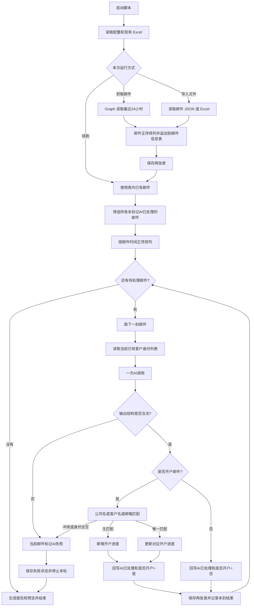

# 当前 Workflow 详细说明

更新日期：2026-11-03。本文记录本地 Excel 模拟版脚本的当前实际行为。

当前落地的 workflow 是：

**读取邮件 → 存入邮件信息表 → 挑出未完成邮件 → 按时间逐封处理 → AI 一次性识别和提取 → 程序匹配客户 → 新增或更新开户进度 → 回写邮件状态 → 保存 → 处理下一封。**

你原来的 `My workflow 2.json` 仍是未启用的流程草图。现在实际执行这套流程的是 Python 脚本，Excel 的两个工作表模拟两张多维表格。

下面按真实执行顺序细拆。



## 第 1 步：启动脚本，确定这次要做什么

目前有四种主要入口：

| 运行方式 | 邮件从哪里来 | 是否抓邮箱 | 是否调用 AI |
|---|---|---:|---:|
| 默认运行／`--fetch` | 指定邮箱最近 24 小时邮件 | 是 | 是 |
| `--input 文件路径` | 已有邮件 JSON 或 Excel | 否 | 是 |
| `--resume` | 当前模拟工作簿中的未完成邮件 | 否 | 是 |
| `--init` | 只创建或检查两张空表 | 否 | 否 |

另外有几个控制参数：

| 参数 | 实际作用 |
|---|---|
| `--import-only` | 只抓取或导入邮件，入表后结束，不调用 AI |
| `--limit 3` | 本轮最多分析最早的 3 封未完成邮件 |
| `--model 模型名` | 本次明确指定模型，覆盖 `.env` 中的模型名 |
| `--workbook 路径` | 使用指定的模拟工作簿 |
| `--env 路径` | 从指定文件读取模型和 Graph 配置 |
| `--config 路径` | 使用指定的身份识别配置 |
| `--prompt 路径` | 使用指定的提示词 |
| `--no-preview` | 结束时不生成表格预览图 |

本次成功运行用的是：

```powershell
.\run_onboarding.ps1 --resume --model 'qwen/qwen3.8-max'
```

意思是：**不重新抓邮件，处理现有 Excel 里的未完成邮件，本次模型指定为 Qwen 3.8 Max。**

脚本没有把 Qwen 写死。以后不传 `--model`，仍会读取 `.env` 中的 `LLM_MODEL`。

## 第 2 步：读取运行配置，建立本次运行

程序依次做这些检查：

1. 找到 Python、Node.js 和 Excel 写入依赖。
2. 检查 `--limit` 是否为正数。
3. 如果是 `--resume`，检查工作簿是否存在。
4. 如果指定 `--input`，检查输入文件不能就是输出工作簿本身。
5. 如果本次需要 AI，读取模型配置。
6. 检查主接口、主密钥、模型名是否有配置。
7. 检查接口地址格式和超时时间。
8. 读取身份配置。
9. 读取提示词。
10. 创建本次运行目录和运行编号。

这里的“检查模型配置”只是检查配置是否齐全、格式是否合理，**不会先发一封测试请求确认模型可用**。

本次正式程序也不会自动先跑那 8 个测试场景。那 8 个场景是单独运行的验收测试。

## 第 3 步：加载两张表

目前是同一个 Excel 文件中的两个工作表：

| 工作表 | 一行代表什么 |
|---|---|
| 邮件信息表 | 一封邮件 |
| 开户进度表 | 一笔开户申请；第一版按一个客户一个邮箱、一笔申请处理 |

程序启动时，会把两张表读进内存。

如果工作簿不存在，就准备创建这两张表。

如果工作簿已经存在，会检查：

- 是否恰好包含这两张工作表。
- 必需字段是否齐全。
- 有没有重复表头。
- 每条记录是否有 `record_id`。
- 同一张表内有没有重复的 `record_id`。

**Excel 是当前的持久化数据源。** 运行报告里的 JSON 不会反过来覆盖 Excel。

启动之后，每封邮件所读取的“当前客户列表”，来自内存中最新的进度表状态。上一封邮件刚新增的客户，下一封就能看到。

## 第 4 步：如果选择抓取，读取最近 24 小时的邮件

这个分支直接复用了 `mail_export_source` 里的 Graph 客户端、字段映射和 HTML 清理函数。

具体过程是：

1. 固定本次抓取结束时间 `T`。
2. 计算开始时间 `T - 24小时`。
3. 使用 `.env` 中指定的租户、应用、密钥和邮箱。
4. 向 Microsoft 获取访问令牌。
5. 请求指定邮箱的邮件。
6. 按 `receivedDateTime` 筛选。
7. 每页请求最多 100 封。
8. 如果返回下一页地址，继续请求下一页。
9. 收集完所有页。
10. 再在本地按时间从早到晚排序。

时间范围是：

```text
开始时间 ≤ receivedDateTime < 结束时间
```

不是“今天零点到现在”，也不是“上次成功执行之后”。

查询范围是指定邮箱的所有文件夹，并没有再加“只看收件箱”的筛选。

还有一个实际实现细节：

**完整流程直接复用抓取函数，不要求先生成一份单独的 `mail_last24h.xlsx` 再读回来。**

两条路径都可以：

```text
直接抓取：
Graph → 邮件映射 → 邮件信息表
```

```text
使用原导出程序：
Graph → 导出 JSON/Excel → --input 导入 → 邮件信息表
```

## 第 5 步：把邮件整理成统一字段

抓取来的邮件会经过这些整理：

- 发件人姓名和邮箱分别取出。
- 主收件人姓名、邮箱分别拼接成字符串。
- 抄送人姓名、邮箱分别拼接。
- 密送人姓名、邮箱分别拼接。
- 邮件主题保留。
- HTML 正文清理成纯文本。
- 保留是否有附件。
- 初始 AI 状态写为 `AI未完成`。
- 初始“是否为开户邮件”留空。

HTML 清理会去掉标签、脚本、样式等内容，保留文字和分段。

**程序没有把正文中的历史引用完全删除。** 去 HTML 后的整段正文会交给 AI，提示词要求 AI 区分本次新增内容与历史引用。

因此，“只分析本次邮件”在当前实现中的含义是：

> 不另外查询历史邮件，但本封正文自带的引用内容仍然存在，由 AI 判断如何使用。

附件只保留 `hasAttachments`。当前不会下载附件、读取 PDF、做 OCR 或验证附件资料是否合格。

如果从旧的导出文件导入，六个长表达式表头会映射成统一名称，例如：

```text
toRecipients.names
toRecipients.addresses
ccRecipients.names
ccRecipients.addresses
bccRecipients.names
bccRecipients.addresses
```

原始导出文件本身不会因此被改写。

## 第 6 步：把邮件追加到邮件信息表

默认邮件信息表有以下 19 列：

| 字段 | 用途 |
|---|---|
| `internetMessageId` | 邮件自身的消息标识，保留作来源信息和日志记录 |
| `conversationId` | 邮件会话标识，当前不用于自动拉取历史会话 |
| `receivedDateTime` | 邮件时间，用于排序 |
| `webLink` | 原邮件链接 |
| `hasAttachments` | 是否有附件 |
| `from.emailAddress.name` | 发件人姓名 |
| `from.emailAddress.address` | 发件人邮箱 |
| `toRecipients.names` | 主收件人姓名 |
| `toRecipients.addresses` | 主收件人邮箱 |
| `ccRecipients.names` | 抄送人姓名 |
| `ccRecipients.addresses` | 抄送人邮箱 |
| `bccRecipients.names` | 密送人姓名 |
| `bccRecipients.addresses` | 密送人邮箱 |
| `subject` | 邮件主题 |
| `body.content（去除html）` | 纯文本正文 |
| `AI处理` | 处理状态 |
| `是否为开户邮件` | 成功分析后写“是”或“否” |
| `处理说明` | AI 判断依据，或失败原因 |
| `record_id` | 这条表格记录的系统标识 |

这里要区分两个 ID：

- `internetMessageId`：邮件自身的标识。
- `record_id`：程序创建的表格记录标识。

后面更新邮件状态，使用的是 **`record_id`**。

当前没有用 `internetMessageId` 做去重。相同文件再次导入，会再次追加记录，并生成新的 `record_id`。

如果是导入文件，原文件已有的 `AI处理` 值会保留；只有为空时才补为 `AI未完成`。

所有本次导入的邮件追加完后，先保存一次工作簿，再开始 AI 处理。

## 第 7 步：建立本轮待处理队列

程序读取邮件信息表，选择条件实际上只有：

```text
AI处理 != AI已处理
```

所以这些都会进入队列：

| 当前值 | 是否进入待处理队列 |
|---|---:|
| `AI未完成` | 是 |
| `AI失败` | 是 |
| 空白 | 是 |
| 其他文字 | 是 |
| `AI已处理` | 否 |

然后：

1. 检查邮件时间能否解析。
2. 检查时间是否带时区。
3. 按 `receivedDateTime` 从早到晚排序。
4. 如果有 `--limit`，只取排序后的前 N 封。
5. 开始逐封处理。

当前是**顺序执行**。上一封完成保存后，才开始下一封。

这里的正序针对的是“当前所有未完成邮件”。当前没有再检查“该客户之前已经处理过的最新邮件时间”。

所以以后补导入一封更早的邮件，它仍会进入待处理队列，并可能更新现有进度。

## 第 8 步：取出一封邮件，读取当前已有客户身份

每分析一封邮件前，程序都会从当前开户进度表读取这三个字段：

```text
公司名称
客户名称
邮件
```

形成类似这样的列表：

```json
[
  {
    "公司名称": "A公司",
    "客户名称": "张三",
    "邮件": "zhang@example.com"
  },
  {
    "公司名称": "B公司",
    "客户名称": "",
    "邮件": "finance@example.com"
  }
]
```

如果进度表还没有任何客户，就传空列表：

```json
[]
```

这个列表只用于客户身份识别和名称规范化。

**不会把旧卡点、旧摘要、旧经办人、旧球权传给 AI。**

已有客户来源就是开户进度表，当前没有独立的第三张客户主数据表。

## 第 9 步：组装一次 AI 请求

每封邮件只有一次业务 AI 调用，请求中包含：

| 输入 | 具体内容 |
|---|---|
| 系统提示词 | 当前完整开户处理提示词 |
| 身份配置 | 内部域名、合规提示、本部门身份配置 |
| 发件人 | 姓名、邮箱 |
| 主收件人 | 姓名、邮箱 |
| 抄送人 | 姓名、邮箱 |
| 密送人 | 姓名、邮箱 |
| 主题 | 本封邮件主题 |
| 正文 | 去 HTML 后的本封完整正文 |
| 附件标记 | 是否有附件 |
| 已有客户列表 | 公司名称、客户名称、客户邮箱 |

邮件时间、会话 ID、原邮件链接等元数据，目前没有放进 AI 请求。邮件时间由程序用于排序。

请求本身是：

```text
system：提示词
user：本封邮件信息 + 身份配置 + 已有客户身份列表
```

每次都是独立请求，没有额外的聊天历史或长期会话记忆。

模型请求使用：

- 主配置中的接口。
- 主配置中的密钥。
- 本次指定的模型，或 `.env` 的模型。
- 非流式返回。
- 当前开启 JSON 模式。

当前没有模型失败后自动切换备用模型或备用接口的机制。

## 第 10 步：AI 在这一次调用中完成全部语义判断

AI 一次性完成以下工作。

### 判断是否属于开户

跟踪范围包括：

- 开户接洽。
- 开户指引。
- 资料收集。
- KYC。
- 补件。
- 审核。
- 开户成功、拒绝或撤回。

排除范围包括：

- 广告、活动邀约。
- 发票、预算。
- 内部测试。
- 内部人事、权限、政策、数据推送。
- 开户后的独立 EDDA、充值、权限开通等事项。

### 识别实际客户

AI 综合参与人、主题、正文识别：

- 开户主体公司。
- 客户联系人。
- 客户邮箱。

发件人可能是客户，也可能是销售、开户团队或合规。因此没有直接把发件人邮箱写成客户邮箱。

找不到公司名或客户姓名时，允许留空。识别到了客户邮箱，也可以继续建立进度。

### 判断球权

当前这六条是提示词规则，由模型判断：

| 本封邮件情况 | 球权 |
|---|---|
| 客户发来邮件 | 球在我方 |
| 我方发给客户，合规只在抄送 | 球在客户 |
| 我方发给合规，客户不在主收件人里 | 球在合规 |
| 合规发邮件，客户在主收件人或抄送里 | 球在客户 |
| 合规只回复我方，没有客户 | 球在我方 |
| 内部同事讨论 | 默认球在我方 |

**这部分没有在 Python 中另写一套硬编码规则覆盖模型答案。** 程序只检查返回的球权文字是否合法。

这也是为什么单独测试了 Flash 和 Max 的实际表现。

### 提取进度内容

AI 提取：

- 本次明确的卡点。
- 是否明确解决卡点。
- 本次进展摘要。
- 内部客户对接人。
- 判断依据。

经办人指销售或客户经理，和“球在谁方”是两个独立字段。球在我方，并不意味着经办人一定能识别出来。

## 第 11 步：AI 返回一个固定结构的结果

结构示例：

```json
{
  "is_onboarding": true,
  "company_name": "A公司",
  "customer_name": "张三",
  "email": "zhang@example.com",
  "ball_in_court": "球在我方",
  "blocker": null,
  "blocker_resolved": false,
  "summary": "客户已提交文件扫描件，等待我方核对。",
  "handler": null,
  "reason": "本封为客户提交开户资料的邮件，球在我方。"
}
```

各字段含义如下：

| AI 输出字段 | 含义 |
|---|---|
| `is_onboarding` | 是否开户邮件 |
| `company_name` | 开户主体公司 |
| `customer_name` | 客户联系人 |
| `email` | 客户邮箱 |
| `ball_in_court` | 球在谁方 |
| `blocker` | 本次明确的卡点，未提及为 `null` |
| `blocker_resolved` | 是否明确解决卡点 |
| `summary` | 本次实际进展 |
| `handler` | 内部客户对接人，未明确为 `null` |
| `reason` | 判断依据 |

**一封邮件目前只返回一个客户结果。** 当前没有把一封涉及多个开户客户的邮件拆成多条客户结果。

## 第 12 步：程序校验 AI 输出

程序会检查：

1. 返回内容能否解析为 JSON。
2. 最外层是否是对象。
3. 必需字段是否存在。
4. 公司、姓名、邮箱、球权、判断依据是否为字符串。
5. 两个布尔字段是否是真正的 `true/false`，不能是字符串 `"true"`。
6. 卡点、摘要、经办人是否为字符串或 `null`。
7. 非空邮箱是否符合简单的单邮箱格式。
8. 球权是否属于允许值。
9. 开户邮件是否有非空摘要。
10. “卡点已解决”是否与“仍存在卡点”互相冲突。

允许的球权值是：

```text
球在我方
球在客户
球在合规
空字符串
```

字符串中的首尾空格会被去掉。

卡点、摘要、经办人如果只是空字符串，会转为 `null`。

这里检查的是**结构和字段一致性**，没有第二个模型再次判断业务结论是否正确。

## 第 13 步：如果不是开户邮件，直接走非开户分支

这个分支不创建或修改开户进度。

只更新当前邮件记录：

| 邮件信息表字段 | 写入内容 |
|---|---|
| `AI处理` | `AI已处理` |
| `是否为开户邮件` | `否` |
| `处理说明` | AI 返回的判断依据 |

例如活动邀请可能写为：

```text
AI处理：AI已处理
是否为开户邮件：否
处理说明：活动主办方发送的入场通知，不涉及开户事项。
```

然后保存，记录本封结果，进入下一封。

## 第 14 步：如果是开户邮件，由程序匹配已有客户

这一步由程序完成，AI 不直接决定“新增还是更新”。

匹配条件是：

```text
公司名称相等
或
客户名称相等
或
客户邮箱相等
```

每个字段先做三项标准化：

1. 统一全半角。
2. 去掉首尾空白。
3. 忽略大小写。

程序没有做这些处理：

- 没有公司名包含匹配。
- 没有程序层面的模糊相似度。
- 没有把简称、全称自动认定为相同。
- 没有邮箱优先于公司名的匹配优先级。

模型可以参考已有客户列表输出规范名称，但最后仍由程序做文本相等比较。

匹配结果分为四种：

| 结果 | 后续动作 |
|---|---|
| 没有命中 | 新增开户进度 |
| 唯一命中一条 | 更新该条进度 |
| 命中两条或更多记录 | 判为匹配冲突，本封失败 |
| 公司名、客户名、邮箱全部为空 | 无法识别客户，本封失败 |

空字段不参与匹配，不会因为两条记录姓名都为空而命中。

举三个例子：

| 情况 | 程序怎么处理 |
|---|---|
| 公司名命中 A 记录，邮箱也命中 A 记录 | 仍是唯一命中 A，更新 A |
| 公司名命中 A，邮箱命中 B | 冲突，不会自行选择 A 或 B |
| 公司名、姓名为空，邮箱命中 A | 更新 A |

匹配只是找到目标记录。真正更新时使用目标的 **`record_id`**，不依赖 Excel 行号。

## 第 15 步：新增或更新开户进度

开户进度表默认有这 9 列：

| 字段 | 含义 |
|---|---|
| 公司名称 | 开户主体 |
| 客户名称 | 客户联系人 |
| 邮件 | 客户邮箱 |
| 球在谁方 | 当前球权 |
| 卡点 | 当前保存的卡点文本 |
| 简要描述 | 当前最新摘要 |
| 经办人 | 内部客户对接人 |
| 最新ai更新时间 | 本次分析写入的北京时间 |
| `record_id` | 进度记录的系统标识 |

新增记录时生成新的 `record_id`；更新记录时保留原 ID。

各字段的具体写入规则是：

| 字段 | 本次有值 | 本次为空／未提及 |
|---|---|---|
| 公司名称 | 写入新值 | 保留旧值 |
| 客户名称 | 写入新值 | 保留旧值 |
| 邮件 | 写入新值 | 保留旧值 |
| 球在谁方 | 写入新值 | 保留旧值 |
| 简要描述 | 替换为本次摘要 | 开户邮件摘要为空会校验失败 |
| 经办人 | 替换为本次经办人 | 保留旧值 |
| 最新ai更新时间 | 每封开户邮件都更新 | 不适用 |

“最新ai更新时间”是**程序分析和写入的时间**，不是邮件发送时间。

卡点有单独规则：

| AI 结果 | 卡点字段怎么处理 |
|---|---|
| `blocker=null`，`blocker_resolved=false` | 保留旧卡点 |
| `blocker` 有具体文字 | 整段替换旧卡点 |
| `blocker_resolved=true` | 清空旧卡点 |
| 声称已解决，同时又返回非空卡点 | 校验失败 |

这里的粒度是“整个卡点字段”。

例如：

```text
旧卡点：缺地址证明
本次：请查收附件
```

如果 AI 没有明确确认资料通过，旧卡点保留。

但如果本次返回了一个新的卡点文本，程序会整段替换，**不会把新旧补件清单逐项合并**。当前也没有逐个资料项的完成状态。

## 第 16 步：开户进度处理成功后，回写当前邮件状态

成功路径写入：

| 邮件信息表字段 | 写入内容 |
|---|---|
| `AI处理` | `AI已处理` |
| `是否为开户邮件` | `是` |
| `处理说明` | AI 返回的判断依据 |

原始邮件主题、正文、收发件人等字段保持原值。

还有一个数据关系细节：

- 邮件信息表目前没有额外的“对应开户进度 ID”列。
- 开户进度表目前没有额外的“最新来源邮件 ID”或“最新邮件链接”列。
- 本封邮件与进度记录的对应关系，记录在运行日志中的 `mail_record_id`、`progress_record_id`。

进度表中的“邮件”列始终是**客户邮箱地址**，不是原文链接。

## 第 17 步：保存两张表，再处理下一封

每封邮件处理完，程序都会调用一次保存。

保存时实际发生的是：

1. 把当前内存中的两张表交给 Excel 写入进程。
2. 生成两张工作表。
3. 写入全部记录和字段。
4. 设置表头、筛选、冻结首行、日期格式、球权颜色等。
5. 检查写入值。
6. 先保存到临时文件。
7. 保存成功后替换正式工作簿。
8. 返回保存成功。
9. 把本封处理结果写进日志。
10. 开始下一封邮件。

**业务层是按字段增量更新，Excel 文件层面则是重新保存整个工作簿。**

这也是为什么它现在模拟的是“多维表格记录操作”，而不是直接对某个 Excel 单元格执行一次局部写入。

程序运行中主要使用内存状态；不会在每封邮件前重新读取磁盘上的人工修改。

## 第 18 步：遇到失败时怎么走

不同失败阶段的处理不同：

| 失败阶段 | 当前行为 |
|---|---|
| 配置缺失、文件结构不合法 | 直接报错结束 |
| 抓邮件失败 | 结束，不把部分抓取结果追加进表 |
| 输入文件字段不齐 | 结束，不进入逐封 AI 循环 |
| 待处理邮件时间不合法 | 排序阶段报错，尚未开始逐封分析 |
| 模型请求失败或超时 | 当前邮件标为 `AI失败` |
| AI 输出不是合法结构 | 当前邮件标为 `AI失败` |
| 客户三项身份全空 | 当前邮件标为 `AI失败` |
| 匹配到多个客户记录 | 当前邮件标为 `AI失败` |
| Excel 保存失败 | 直接停止，以磁盘上最后成功保存的状态为准 |

对于模型、输出校验、客户匹配这类单封邮件失败：

```text
当前邮件 AI处理 = AI失败
当前邮件 处理说明 = 具体错误
保存
停止本轮
后面的邮件暂不处理
```

停止的原因是保持顺序。例如：

```text
09:00 邮件失败
10:00 邮件未处理
11:00 邮件未处理
```

续跑时仍然是：

```text
先重试09:00
成功后处理10:00
再处理11:00
```

不会先处理新邮件，再回头用旧邮件覆盖。

但重试需要重新执行 `--resume`。当前模型调用本身没有自动重试循环。

Graph 抓取接口另外有自己的重试：

| 请求 | 自动重试 |
|---|---|
| Graph 网络错误或指定的临时 HTTP 错误 | 最多尝试 3 次，间隔 1 秒、2 秒 |
| AI 请求 | 本轮只尝试一次，失败后停止 |
| 切换备用模型 | 不自动执行 |

## 第 19 步：续跑时具体做什么

执行 `--resume` 后：

1. 重新读取已保存的 Excel。
2. 不抓邮箱。
3. 不重新导入来源文件。
4. 选出所有不等于 `AI已处理` 的邮件。
5. 按时间正序排列。
6. 重新调用 AI 处理最早的未完成邮件。
7. 已处理邮件跳过。

续跑不会从日志里直接复用上一次的 AI 答案。

如果上次模型已经返回，但 Excel 保存失败，下次仍可能重新调用模型分析该封邮件。

如果所有邮件都已经是 `AI已处理`，续跑不会再产生业务 AI 调用。

## 第 20 步：本轮结束，生成结果记录

每次运行都会有一个独立目录，主要包含：

| 文件 | 内容 |
|---|---|
| `results.jsonl` | 逐封记录的模型结果、成功／失败动作、邮件记录 ID、关联进度记录 ID |
| `run_report.json` | 本轮统计、使用模型、剩余数量、整体完成状态 |
| `previews` | 最终表格预览图 |

本次实际跑出的结果是：

| 项目 | 数量 |
|---|---:|
| 处理邮件 | 19 |
| 开户邮件 | 7 |
| 非开户邮件 | 12 |
| 新增进度 | 5 |
| 更新已有进度 | 2 |
| 失败 | 0 |
| 剩余未完成 | 0 |

“更新 2 次”指两封邮件分别更新已有记录，不表示额外产生了两条进度。

## 当前实现边界

以下几项直接影响这套 workflow 的使用：

- **触发方式是手动启动。** 当前没有设置定时任务或邮件到达触发器。
- **抓取窗口固定为运行时往前 24 小时。** 没有上次成功抓取时间水位，也没有停跑补抓。
- **导入是追加。** 没有邮件去重，相同来源重复导入会产生新邮件记录。
- **AI 只分析当前邮件。** 不另外查询历史会话，不读取进度表旧卡点。
- **一封邮件只提取一个客户。** 没有多客户拆分。
- **球权由 AI 判断。** 程序只验证返回值是否合法。
- **客户匹配由程序决定。** 三字段任意一个命中，且必须唯一命中。
- **卡点是一个文本字段。** 没有逐项补件清单或历史进度时间线。
- **没有独立的开户状态字段。** “待补件、审核中、已完成”等目前主要体现在摘要和卡点里。
- **附件和外部开户门户不参与自动读取。** 当前进度依据来自邮件内容。
- **当前没有写入飞书。** 实际持久化还是本地 Excel。

## 未来多维表格适配接口

未来换成多维表格时，当前业务逻辑依赖的表格接口只有这四个：

| 接口 | 当前本地实现 |
|---|---|
| `list_records(table)` | 获取指定表的记录 |
| `create_record(table, fields)` | 新增记录并生成 `record_id` |
| `update_record(table, record_id, fields)` | 按记录 ID 更新指定字段 |
| `flush()` | 保存当前两张表 |

客户识别、三字段匹配、字段保留和逐封循环都在表格接口之外。以后接飞书，需要实现实际的飞书记录适配器，把这四类操作对接到对应 Table。

## 对应源码

- [运行入口](C:/Users/abc/Documents/ChatGPT/更新inbox/onboarding_source/run_onboarding.py:68)
- [逐封处理逻辑](C:/Users/abc/Documents/ChatGPT/更新inbox/onboarding_source/workflow.py:55)
- [AI 请求与校验](C:/Users/abc/Documents/ChatGPT/更新inbox/onboarding_source/model.py:64)
- [表格字段与存储](C:/Users/abc/Documents/ChatGPT/更新inbox/onboarding_source/storage.py:19)
